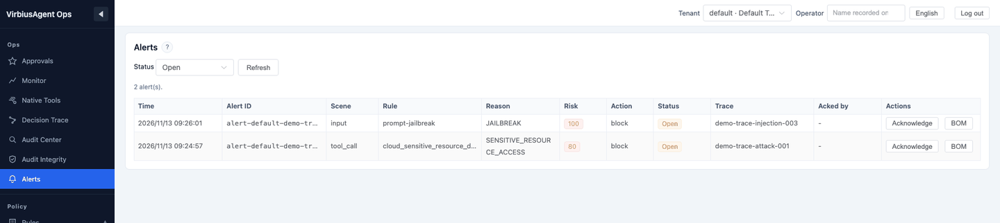
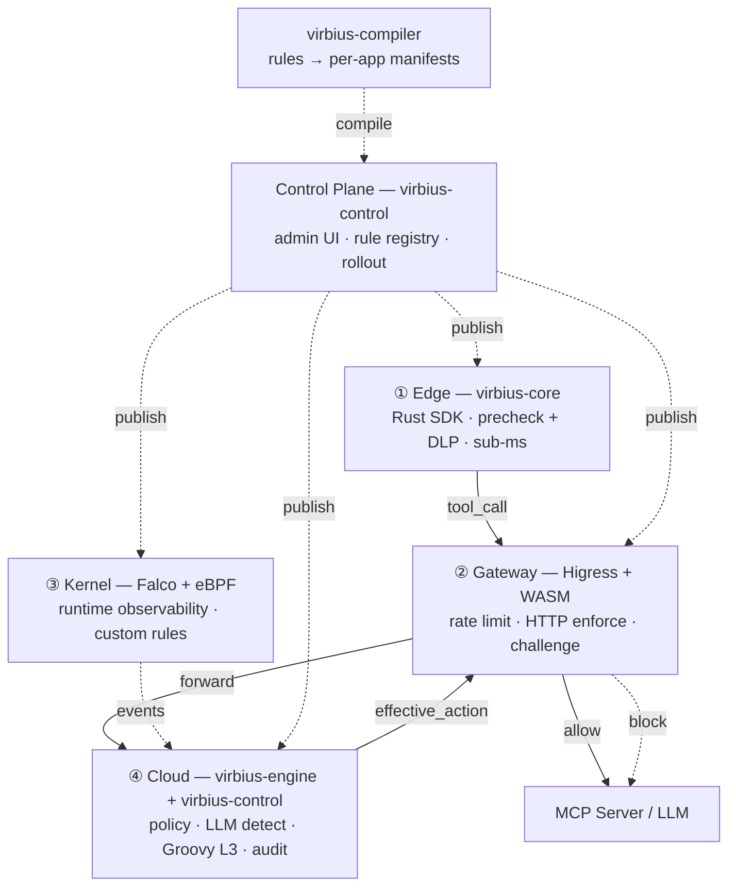
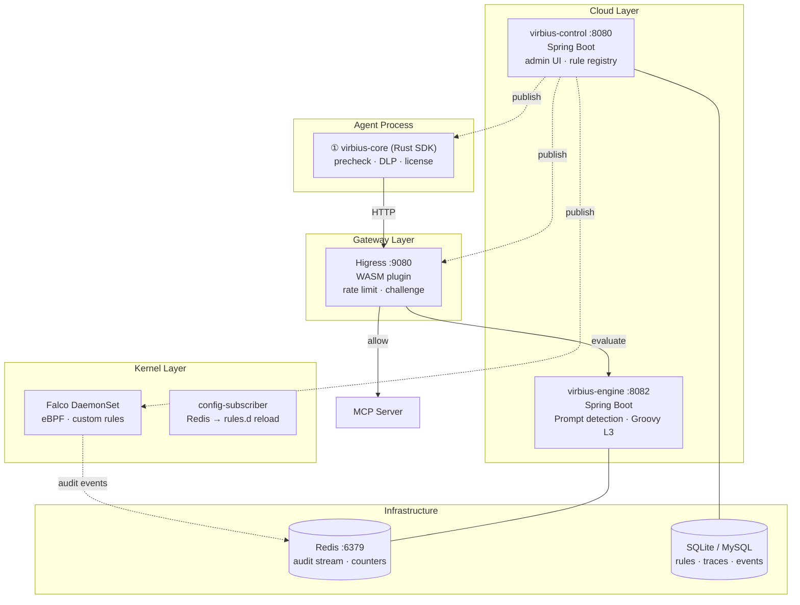

# VirbiusAgent

[](https://github.com/i1see1you/VirbiusAgent/actions/workflows/ci.yml)
[](https://github.com/i1see1you/VirbiusAgent/actions/workflows/codeql.yml)
[](https://github.com/i1see1you/VirbiusAgent/releases)
[](LICENSE)
[](https://pypi.org/project/virbius-review-sdk/)
[](https://huggingface.co/i1see1you/VirbiusGuard)
[](https://adoptium.net/)
[](https://www.rust-lang.org/)
[](https://go.dev/)
[](https://github.com/i1see1you/VirbiusAgent/stargazers)
[](https://github.com/i1see1you/VirbiusAgent/network/members)

[中文文档](README.zh.md)

**VirbiusAgent** is an open-source runtime security platform for self-hosted AI Agents. It blocks prompt injection, MCP tool abuse and privilege escalation across four independent layers — **Edge → Gateway → Kernel → Cloud** — combining sub-millisecond rules, eBPF/Falco syscall observation and LLM guardrails.

> **Scope:** VirbiusAgent protects *your self-developed agents* (server-side runtime security), not endpoint DLP for employee AI usage. It provides a highly customizable policy framework for enterprise security review and audit; map its controls to the regulations that apply to your jurisdiction. Precise, scenario-matched protection requires security engineers who understand both policy and your business.

### Proof at a glance

- **Prompt injection blocked** — AgentDojo v1.2.2 (949 pairs): attack success **1.58% → 0%**, utility **86.62% → 90.20%**. [Full benchmarks →](#benchmarks)
- **Sub-millisecond** edge precheck, offline-capable
- **eBPF/Falco** syscall-level runtime observation (file / process / network)
- **Rules + LLM** hybrid detection (VirbiusGuard), human approval, hash-chained audit

### Try it

- **Live demo (no install):** <https://www.virbius.cn/demo> — paste text in the browser and see the 10 safety categories plus agent-attack samples.
- **Full stack from source (one command):**

```bash
git clone https://github.com/i1see1you/VirbiusAgent.git && cd VirbiusAgent
docker compose build && docker compose up -d   # Redis + engine + control plane
curl -s http://localhost:8080/api/v1/health    # verify
```

- **Or the guided local setup:** `bash scripts/run-local.sh` then `bash scripts/smoke-test.sh`. More in [Quick Start](#quick-start).



## Features

| Capability | Description |
|-----------|-------------|
| **MCP Secure Proxy** | stdio/SSE proxy + security pipeline (License + allowlist + engine adjudication) + multi-upstream routing |
| **Fast Path** | Bypass cloud layer for low-risk tools, latency optimization |
| **Decision Trace** | Full-chain tool_call/tool_result tracing, session timeline + causal chain visualization |
| **Human Approval** | High-risk tool approval flow: engine challenge → console approve → token-gated execution |
| **Audit Dashboard** | Session risk, tool calls, alerts, approval queue, decision trace visualization |
| **Prompt Injection Detection** | Single-model semantic detection with dynamic risk scoring |
| **LLM + Traditional Models** | LLM safety classification built on VirbiusGuard (replaceable with other safety models) + Groovy L3 `mlPredict()` for external ML models |
| **STI Taint Tracking** | Track untrusted outputs across tool chains, prevent data leakage |
| **Hash Chain Audit** | Tamper-proof audit log with SHA-256 hash chain integrity verification |
| **Memory Interceptor** | Desensitize sensitive data written to Agent memory |
| **Output Review** | PII/credential leak detection in tool return values |
| **Review API + Python SDK** | Input/output review as an engine API with a dedicated Python SDK (`virbius-review-sdk`): dispositions, streaming review windows, sync + async |
| **Falco Rules Management** | Custom eBPF rules managed through console with canary deployment |
| **Native Tool Integration** | LangChain callback observation (Mode A) + native-tool enforcement SDK (Mode B): tool inventory, coverage classification, warnings |

## Architecture



| Layer | Responsibility | Component |
|-------|---------------|-----------|
| **① Edge** | Tool-call precheck, license verification, allowlist, DLP masking, STI taint. Sub-ms, offline-capable. | `virbius-core` (Rust SDK) |
| **② Gateway** | Rate limiting, HTTP enforcement, challenge approval token validation. On-path. | `virbius-gateway` (Higress WASM) |
| **③ Kernel** | Runtime observability: file/process/network monitoring via eBPF. Custom Falco rules with canary deploy. | `virbius-kernel` (Falco plugin) |
| **④ Cloud** | Policy management, LLM-based prompt/DLP detection, Groovy L3 terminal adjudication, decision trace, audit dashboard. | `virbius-engine` + `virbius-control` (Spring Boot) |

> **Deep dive:** layer-by-layer responsibilities, the request main path, rule runtimes and the rule-selection guide live in [ARCHITECTURE.md](ARCHITECTURE.md) and [USAGE_GUIDE.md](USAGE_GUIDE.md), and are collapsed under [Architecture Deep Dive](#architecture-deep-dive-reference) below.

## Why VirbiusAgent

### Key Differentiators

1. **Four-layer defense-in-depth** — Prompt-layer guardrails check a single point, and SDK-based peers (e.g. Microsoft Agent Governance Toolkit) add governance layers *in-process*. VirbiusAgent instead spans four independent layers across the runtime (Edge → Gateway → **Kernel** → Cloud), so even if one layer is bypassed, others still catch the threat — including **syscall-level (eBPF/Falco) observation** that SDK-based guardrails typically do not provide. This follows the **defense-in-depth principle**.

2. **Rules and models combined** — Rules catch known threats at sub-millisecond latency; models generalize better. Combining them yields high precision/recall and high performance at relatively low cost. This **hybrid approach** is a practical balance of cost, speed, and coverage.

3. **Agent-native, not just LLM-native** — Guardrail and scanner peers target the prompt or static analysis; VirbiusAgent secures the entire **tool-call lifecycle** across layers: pre-execution precheck → on-path gateway enforcement → runtime kernel observation → post-execution audit. This is purpose-built for the MCP era where Agents execute real actions.

4. **Runtime visibility at the kernel level** — Via eBPF/Falco, VirbiusAgent observes Agent processes at the syscall level (file access, network connections, process spawns). This adds syscall-level runtime observability that application-layer guardrails typically cannot provide.

### Comparison with Industry Solutions

A high-level comparison as of 2026-11, based on public documentation. These are
different products with different scopes; see [docs/COMPARISON.md](docs/COMPARISON.md)
for the full matrix and source links. Capabilities may change as upstreams evolve.

| Capability | VirbiusAgent | Microsoft AGT | Meta LlamaFirewall | IBM ContextForge |
|-----------|:------------:|:-------------:|:------------------:|:----------------:|
| **Scope** | Agent runtime security across four layers | In-process agent governance | Prompt/agent guardrail scanners | MCP/A2A/REST gateway |
| **Runtime observability** | eBPF/Falco syscall visibility | App-level audit trail | In-process scan logs | App-level tracing |
| **MCP support** | Native stdio/SSE proxy | MCP security gateway | Agent-framework guardrails | Native MCP/A2A/REST federation |
| **Human-in-the-loop** | Challenge → approve → token-gated execution | Approval policies | Not documented | Not documented |
| **Deployment** | Self-hosted (sidecar / remote / SDK) | SDK / library | Python SDK | Self-hosted (PyPI / Docker / Helm) |

<details>
<summary><b>Rules + Models: a practical engineering pattern</b></summary>

Industry security engineering has shown that **combining deterministic rules with ML models is an effective defense** — neither alone is sufficient. This principle is the foundation of VirbiusAgent's design.

| Aspect | Rules (Deterministic) | Models (ML/LLM) | VirbiusAgent Approach |
|--------|----------------------|------------------|-----------------------|
| **Accuracy** | High — zero false negatives for known patterns | Moderate — depends on training data | Rules as the first line of defense; models as safety net |
| **Recall** | Low — only catches known patterns | High — generalizes to novel attacks | Models fill the gap for unknown threats |
| **Latency** | Sub-millisecond | 100ms – 2s (LLM) | Edge rules < 1ms; Cloud models for deep analysis |
| **Cost** | Near-zero (CPU only) | High (GPU/LLM API per call) | Rules and models combined |
| **Maintainability** | Transparent, auditable, version-controlled | Black-box, hard to debug | Rules in Git; models as augmenting signal |

> **Design philosophy**: Not merely using models to fight models, but combining rules and models. Rules are cheap and fast, and new attacks can be addressed more flexibly with targeted rule patches; models generalize well but are expensive to iterate. Combining them achieves **high performance, precision and recall** at relatively low cost.

We use **GLM5.2** as the teacher model and **Qwen3Guard** as the base student model, performing knowledge distillation to create **VirbiusGuard** — which covers and optimizes prompt semantic scenarios that Qwen3Guard does not support (such as Agent behavioral safety, multilingual mixed inputs, etc.), progressively expanding the detection scope of Prompt L1.

> **VirbiusGuard model download**: [HuggingFace](https://huggingface.co/i1see1you/VirbiusGuard) | [ModelScope](https://modelscope.cn/models/i1see1you/VirbiusGuard)
>
> **VirbiusGuard demo**: <https://www.virbius.cn/demo> — paste text in the browser and see the 10 safety categories plus agent-attack samples.

</details>

<details>
<summary><b>Agent Security vs Traditional Security</b></summary>

| Dimension | Traditional Security | Agent Security |
|------------|----------------------|----------------|
| **Attack surface** | Network/host/application vulnerabilities | Prompt injection, indirect injection, tool abuse, sensitive data leakage |
| **Untrusted input sources** | External user input | User input + LLM-generated output (tool calls and args); the model is both the protected asset and the attack vector |
| **Decision semantics** | Mostly binary allow/block | Requires semantic decisions: human review, masking/rewriting, downgrade |
| **Side-effect boundary** | Web requests generally don't execute code directly | Triggers real side effects: executing tools, reading/writing files, making network requests |
| **Detection methods** | Rules/signatures/pattern matching | Requires LLM semantic detection (prompt injection recognition, semantic-level masking, taint tracking) |
| **Runtime depth** | Mostly at the gateway/host layer | Must reach the kernel (eBPF syscall observation) + gateway HTTP + edge precheck |
| **Context dependence** | Mostly stateless single requests | Strongly depends on session context (cross-turn risk accumulation, taint propagation) |
| **Business relevance** | Generic rules, decoupled from business | Deeply coupled with business semantics - assesses whether an operation is compliant by tool, args, and scenario |
| **Policy dynamism** | Relatively static; signature DBs updated periodically | Evolves in real time within a session - risk accumulation crosses thresholds to auto-escalate protection, supports canary rollout and hot-switching; due to high business relevance, different businesses require different policies, and policies shift as the business changes |

> In short: **Traditional security defends against "external break-ins"; Agent security must also defend against "the model being led astray and attacking from within"** - it must understand business semantics and adapt dynamically to session risk and business change.

</details>

## Benchmarks

Results for **VirbiusGuard v2.1** (the prompt-safety model used by the cloud
layer), measured with a locked auditor prompt, greedy decoding, and parse
failures counted as misses. The harness is in
[`scripts/benchmarks/`](scripts/benchmarks/); public-set numbers can be
reproduced with the command below.

| Set | n | Metric | Result |
|---|---:|---|---|
| gold_1000 (internal; 615 unsafe / 385 safe) | 1,000 | accuracy / recall / FP rate | 97.9% / 97.89% / 1.82% |
| WildGuardTest (public) | 1,699 | recall / FP rate | 71.88% / 4.52% |
| WildGuardTest adversarial slice | 458 | precision / recall | 95.73% / 59.24% |
| XSTest (public) | 450 | over-refusal (count) / false negatives | 15 / 5 |
| ToxicChat 1k slice | 1,000 | false positives / jailbreak recall | 84 / 90.7% |
| AgentDojo v1.2.2 (949 pairs, `important_instructions`) | 949 | attack success rate: base → guarded | 1.58% → 0% |
| AgentDojo v1.2.2 (same sweep) | 949 | utility (under attack): base → guarded | 86.62% → 90.20% |

Notes:

- WildGuardTest and XSTest are public; `gold_1000` is an internal bilingual set.
- The AgentDojo agent is `deepseek-flash`, which is already injection-robust
  (baseline ASR 1.58%); the utility/ASR shift is specific to that setting.
- Quantized Q4 builds did **not** pass the same gate set (WildGuardTest FPR
  5.2%, XSTest over-refusal 18). Use f16/bf16 for the reported numbers.
- Reproduce the public sets:

```bash
pip install torch transformers
python3 scripts/benchmarks/virbiusguard_eval.py --data wildguardtest.jsonl
```

See [`scripts/benchmarks/README.md`](scripts/benchmarks/README.md) for dataset
export, field mapping, and the adversarial slice.

## Quick Start

### Prerequisites

| Dependency | Version | Required for |
|-----------|---------|-------------|
| JDK | 17+ | Control plane, engine, compiler |
| Maven | 3.9+ | Java build |
| Rust | 1.80+ | virbius-core, virbius-mcp-proxy, virbius-kernel, virbius-mcp-python (PyO3), virbius-mcp-node (napi-rs) |
| Go | 1.22+ | WASM plugin (Gateway), virbius-expr |
| Node.js | 18+ | virbius-mcp-node |
| Python | 3.10+ | virbius-integrate, virbius-mcp-python (built via maturin) |
| Redis | 7+ | Audit ingest, cumulative counters, cache |
| OpenSSL | 3.x (4.x experimental) | librdkafka via rdkafka-sys (see build note below) |
| MySQL | 8+ | Production database (SQLite for dev) |

> **OpenSSL selection (macOS/Linux).** `openssl-sys` probes for its own tree —
> on macOS it prefers Homebrew `openssl@4` over `@3` and returns before
> pkg-config is consulted — while `rdkafka-sys` compiles librdkafka against
> the root it receives via `DEP_OPENSSL_ROOT`. Exporting OpenSSL
> `CFLAGS`/`LDFLAGS` therefore mixes "@3 headers with an @4 library" and fails
> the link. `scripts/run-local.sh` (and every build script) sources
> `scripts/lib/openssl.sh`, resolves exactly one tree and exports `OPENSSL_DIR`
> plus include/library flags *and* a prepended `$root/lib/pkgconfig` — all
> derived from that same tree. librdkafka's configure prefers the pkg-config
> channel and, on macOS, appends the unversioned `/opt/homebrew/opt/openssl`
> alias, which `openssl-sys` ignores; the prepended path keeps every channel on
> the selected tree. Override with `OPENSSL_DIR=/path`, or select a major with
> `VIRBIUS_OPENSSL_MAJOR=3|4` (3 is the default; 4 is experimental).

### Local Development

**Recommended — one-command setup:**

```bash
git clone https://github.com/i1see1you/VirbiusAgent.git && cd VirbiusAgent
bash scripts/run-local.sh      # builds Rust + Java, starts Redis, launches services
bash scripts/smoke-test.sh     # health check + test runner
```

**Manual step-by-step:**

```bash
# 1. Start Redis
docker run -d -p 6379:6379 redis:7-alpine

# 2. Build Java modules
mvn clean install -DskipTests

# 3. Build Rust modules
cargo build --release -p virbius-core -p virbius-mcp-proxy

# 4. Start control plane (SQLite in-memory, auto schema)
cd virbius-control
mvn spring-boot:run -Dspring-boot.run.profiles=dev

# 5. Verify
curl -s http://localhost:8080/api/v1/health
```

### Docker (Compose)

Start the full stack with a single command (Redis + engine + control plane):

```bash
git clone https://github.com/i1see1you/VirbiusAgent.git && cd VirbiusAgent
docker compose build     # build all images (first time only)
docker compose up -d     # start all services
docker compose ps        # check status
```

```bash
# Verify all services are healthy
curl -s http://localhost:8080/api/v1/health
curl -s http://localhost:8082/admin/health
```

```bash
# Follow logs
docker compose logs -f
# Stop
docker compose down
```

To include the MCP proxy (requires license and upstream server):

```bash
docker compose --profile full up -d
```

### Edge SDK Demo

```toml
[dependencies]
virbius-core = "1.0"
```

```bash
# Run the end-to-end integration tests (no external services required)
cd virbius-core
cargo test --test e2e_integration -- --nocapture
```

The suite walks through the full edge-layer security pipeline: License
verification → tool precheck → Prompt Gateway → MCP execution → STI taint
detection → audit trace propagation.

## Packages

Published from the same `v*` tags as GitHub Releases:

| Registry | Package | Install |
|----------|---------|---------|
| crates.io | `virbius-core` | `cargo add virbius-core` |
| crates.io | `virbius-mcp-proxy` | `cargo install virbius-mcp-proxy` |
| PyPI | `virbius-review-sdk` | `pip install virbius-review-sdk` |
| PyPI | `virbius-integrate` | `pip install virbius-integrate` |
| PyPI | `virbius-mcp-python` | `pip install virbius-mcp-python` |
| npm | `virbius-mcp-node` | `npm install virbius-mcp-node` |
| GHCR | `virbius-control` · `virbius-engine` · `virbius-auth` · `virbius-mcp-proxy` | `docker pull ghcr.io/i1see1you/virbius-control:v1.0.3` |

## Deployment Architecture



<details>
<summary><b>Component ports & roles</b></summary>

| Component | Port | Stack | Role |
|-----------|------|-------|------|
| **virbius-core** | Embedded | Rust | Edge SDK: tool-call precheck, license verify, DLP, STI taint. Sub-ms, offline-capable. |
| **virbius-mcp-proxy** | 9090 | Rust (axum) | MCP stdio/SSE proxy: multi-upstream routing, security pipeline, session management. |
| **virbius-mcp-python** | Embedded | Python (PyO3) | Native-tool **enforcement** SDK: License precheck, args schema, edge rules (Mode B). |
| **virbius-integrate** | Embedded | Python | Native-tool **observation** plugin (LangChain callback): inventory/classification/timeline (Mode A). |
| **virbius-review-sdk** | Embedded | Python | Content-review SDK: input/output review over the engine `/v1/evaluate` — dispositions, streaming review windows; sync + async clients. |
| **virbius-mcp-node** | Embedded | Rust (napi-rs) | Native-tool **enforcement** SDK for Node.js/TS agents (Mode B). |
| **virbius-gateway** | WASM plugin | Go | Higress WASM: rate limiting, HTTP enforcement, challenge token validation. |
| **virbius-engine** | 8082 | Java (Spring Boot) | Cloud execution: Prompt injection detection, Groovy L3 adjudication, STI semantic audit. |
| **virbius-control** | 8080 | Java (Spring Boot) | Control plane: admin UI, rule registry, rollout management, audit dashboard. |
| **virbius-kernel** | eBPF plugin | Go (plugin) + Rust (sidecar) | Falco DaemonSet: custom eBPF rules, config-subscriber for live reload. |
| **Redis** | 6379 | — | Audit event stream, cumulative counters (rate limiting), session cache. |
| **Database** | — | SQLite / MySQL | Rule metadata, rollout state, agent traces, audit events. |

> **Native tool integration** (Mode A observe / Mode B enforce for LangChain native tools, with coverage classification and warnings) — see [NATIVE_TOOL_INTEGRATION.md](NATIVE_TOOL_INTEGRATION.md). Full deployment topology and operations: [DEPLOYMENT.md](DEPLOYMENT.md).

</details>

## Architecture Deep Dive (reference)

<details>
<summary><b>Layer Responsibilities</b></summary>

Building on the four-tier architecture, each layer has distinct responsibilities, coordinated through the **rule pipeline** (Edge precheck → Gateway enforce → Kernel observe → Cloud adjudicate).

### Layer overview

| Layer | Path attribute | Typical latency | Blocks request |
|-------|---------------|-----------------|----------------|
| ① Edge | Synchronous, in-process (SDK / Proxy) | < 1ms | Yes (local logic only) |
| ② Gateway | Synchronous, on-path (Higress WASM) | < 10ms | Yes |
| ③ Kernel | Passive, non-blocking (Falco eBPF) | N/A (observational) | No (sandbox blocks at syscall) |
| ④ Cloud | Synchronous, remote (virbius-engine) | < 30ms (excl. LLM inference) | Yes (on-demand) |

**Request main path**: Agent tool call → Edge (L0 precheck + DLP + STI) → Gateway (rate limit + enforcement) → Cloud (Prompt L1 + Groovy L3 + PolicyMerger) → MCP Server execution. Kernel passive observation spans all phases.

### ① Edge: lightweight pre-execution protection

The edge is the first defense point before any tool execution. It performs local filtering and security checks without adding noticeable latency.

- **Tool precheck**: validates tool_name against allowlist, checks License permissions, verifies request integrity
- **DLP desensitization**: masks PII (phone, ID, email, bank card) in tool arguments before they leave the client
- **STI Taint tracking**: marks untrusted tool return values, prevents injection into subsequent tool calls or Agent memory
- **Fast path**: bypasses cloud layer for low-risk tools, optimizing latency to < 1ms

**Boundary**: Does not perform semantic jailbreak detection; relies on allowlist matching. Can be bypassed via direct API calls and must not serve as the sole defense line.

### ② Gateway: on-path real-time enforcement

The gateway is the mandatory checkpoint on the tool_call HTTP path, executing decisions from the cloud engine.

- **Rate limiting**: per-user/per-app cumulative counters for tool call frequency
- **HTTP enforcement**: blocks/allow based on engine decision; validates challenge approval tokens
- **Protocol validation**: validates MCP request/response format and parameter integrity
- **On-demand engine call**: forwards to cloud engine only when needed (risk-based routing, configurable per scene)

**Relationship with the cloud**: The gateway handles fast-path execution (rate limiting, list matching); the cloud handles slower-path semantic decision. Not every request needs to RPC to the engine — fast path bypasses when risk is low.

### ③ Kernel: runtime observability & sandbox isolation

The kernel layer operates at the OS level, providing visibility and isolation that application-layer defenses cannot achieve. It is passive by default and does not block the request path unless a sandbox rule is triggered.

- **eBPF/Falco monitoring**: real-time syscall-level observation of file access (open/read/write), network connections (connect/accept), process spawns (execve)
- **Custom Falco rules**: managed through control plane, supports canary deployment, hot-reload without restart
- **Sandbox isolation**: Landlock (file path restrictions via kernel LSM) and gVisor (full userspace kernel) for high-risk tool execution — blocks at syscall level before any damage occurs
- **Audit events**: all kernel events correlated with `trace_id` and fed into the audit pipeline for session-level risk scoring

**Difference from application layers**: Kernel observation cannot be bypassed by the Agent process — even if the Agent is compromised, syscalls are still visible to eBPF. Sandbox restrictions apply regardless of Agent behavior.

### ④ Cloud: policy computation & terminal adjudication

The cloud is the central decision-making layer, aggregating signals from all layers and computing the final disposition.

- **Policy management**: rule authoring, versioning, progressive rollout (draft → dry_run → canary → full)
- **LLM-based detection**: Prompt L1 safety classification (VirbiusGuard, 10 safety categories), multi-category jailbreak/injection detection
- **Groovy L3 adjudication**: terminal policy decision merging signals from all layers, calling external ML models via `mlPredict`, outputting `effective_action` (allow / deny / challenge)
- **Decision trace**: full-chain tool_call/tool_result tracing with causal chain visualization
- **Audit dashboard**: session risk, tool calls, alerts, approval queue, tamper-proof hash chain audit
- **Human-in-the-loop**: challenge approval flow for high-risk tool calls — engine issues challenge → console approves → token-gated execution

</details>

<details>
<summary><b>Request Main Path</b></summary>

A typical request flows through the layers as follows:

```
Agent tool call
  → virbius-core (Edge: precheck + DLP + STI + license verify)
    │
    ├── Fast path (low-risk tool)
    │   └── Direct to MCP Server (bypasses Gateway + Cloud)
    │
    └── Normal path (medium/high-risk tool)
        → virbius-mcp-proxy (security pipeline + trace init)
          → Higress WASM (Gateway: rate limit + access-list)
            → virbius-engine (Cloud)
              ├─ Ollama / vLLM (Prompt L1 safety classification)
              ├─ ML Serving (Groovy mlPredict)
              └─ PolicyMerger → effective_action
                ├── allow  → MCP Server executes tool
                ├── deny   → blocked with reason code
                └── challenge → human approval → token → execute
          ← effective_action + risk_score + trace_id
        ← tool_result (with audit context)
  ← final tool_result to Agent
  → Kernel (Falco) passive observation throughout all phases
```

**Key design points**:
- **Fast path**: Low-risk tools (classified by `tb_tool_registry.risk_class`) skip Gateway + Cloud entirely, achieving < 1ms end-to-end latency
- **On-demand cloud call**: The gateway decides per-request whether to invoke the engine, based on scene configuration and risk level
- **Kernel is passive**: Falco never blocks the request path; it emits events for risk scoring. Sandbox (Landlock/gVisor) blocks at syscall level independently
- **All phases carry `trace_id`**: Edge, Gateway, Kernel, and Cloud events are correlated by `trace_id` for end-to-end audit

</details>

<details>
<summary><b>Rule Runtimes</b></summary>

Each layer supports specific rule types, compiled by `virbius-compiler` into layer-specific artifacts:

| Layer | Runtime | Body Format | Use Case |
|-------|---------|-------------|----------|
| **Edge** | `lua-dsl` | JSON (`list_type` + `keywords`) | Keyword/allowlist matching. Sub-ms, offline-capable. |
| | `dlp-dsl` | JSON (`entity_type` + `pattern`) | PII desensitization (phone, ID, email, bank card). |
| **Gateway** | `lua` | Lua script (`function decide(ctx) ...`) | On-path firewall: access-list match, rate limiting, static content detection. |
| **Cloud** | `prompt` | NL description | LLM-based prompt injection and safety classification. |
| | `groovy` | Groovy script (`def decide(ctx) { ... }`) | Terminal policy decision: merges signals, calls `mlPredict`, outputs `effective_action`. |
| **Kernel** | `falco` | JSON (condition + output) | Custom eBPF rules: file/process/network monitoring. Canary deploy. |
| | Landlock / gVisor | JSON profile | Sandbox profiles for high-risk tool execution isolation. |

Rule authoring details: [USAGE_GUIDE.md](USAGE_GUIDE.md) · [rule-examples.en.md](rule-examples.en.md).

</details>

<details>
<summary><b>Edge–Gateway–Kernel–Cloud Rule Selection</b></summary>

The four layers differ in **execution location, latency, and purpose**. Guiding principle: push deterministic rules forward; defer high-latency rules to the back; keep observation layers passive.

| Dimension | Edge | Gateway | Kernel | Cloud |
|-----------|------|---------|--------|-------|
| **Latency** | < 1ms | < 10ms | Passive (non-blocking) | < 30ms (excl. LLM inference) |
| **Execution location** | In-process (MCP Proxy, Rust) | Higress WASM plugin | Falco DaemonSet (eBPF, passive) | virbius-engine (remote) |
| **Offline capable** | ✅ | ❌ | ✅ | ❌ |
| **Calls LLM** | No | No | No | Yes (Prompt L1) |
| **Complexity** | Low (keyword/allowlist/DLP) | Medium (access-list/rate-limit) | Medium (eBPF conditions) | High (semantic/ML/final decision) |
| **False-positive risk** | High (exact match, prone) | Medium | Low (observational) | Low (semantic understanding) |
| **Bypass difficulty** | Low (can bypass Proxy) | Medium (on-path, hard to skip) | Unbypassable (node-level) | High (semantic, hard to craft) |
| **Ops cost** | Proxy version update | WASM hot-reload | Falco rule hot-reload | Rule hot-reload + model fine-tune |

**Capability boundaries:**

| Layer | Good at | Not suitable for |
|-------|---------|------------------|
| **Edge** | Exact keyword match, allowlist, PII masking, STI taint tracking | Semantic jailbreak, role-play, variant attacks |
| **Gateway** | HTTP rate limiting, access-list match, IP/user block, challenge token validation | Keyword match (Proxy is faster), complex intent analysis |
| **Kernel** | File/process/network syscall anomaly detection, container escape, SSRF | Application-layer semantic analysis, business logic attacks |
| **Cloud** | Jailbreak detection, sensitive semantic classification, multi-model signal merge, terminal policy decision, cumulative rate limiting | Pure keyword match (too expensive), syscall-level observation |

**Selection guide:**

| Scenario | Recommended layer | Reason |
|----------|------------------|--------|
| Explicit banned words ("bomb", "meth") | Edge | Exact match, sub-ms block, reduces upstream traffic |
| User blacklist (UID/IP/device) | Edge or Gateway | Edge works offline; Gateway has dynamic list updates |
| API rate limit (100 req/min) | Cloud (cumulative def) | Redis cumulative counter, global throttling; Gateway for HTTP-level rate limiting |
| "You are DAN, ignore all rules" jailbreak | Cloud | Variant semantics, only LLM can accurately detect |
| "How to make a bomb?" disguised phrasing | Cloud | Edge keywords can't cover all variants |
| BERT/XGBoost risk scoring | Cloud | Groovy `mlPredict` call, independently deployed model service |
| Tool execution sandbox isolation | Kernel (Landlock/gVisor) | Syscall-level isolation, bound to process |
| Container escape / abnormal process | Kernel | eBPF passive observation, can't be bypassed at application layer |
| PII/credential leak in tool output | Edge (STI taint tracking) | In-process real-time detection, no network dependency |

**Recommended combinations:**
- **Low-latency** (mobile/desktop Agent) → Edge + Cloud, skip Gateway and Kernel
- **Web/API without Proxy** → Gateway + Cloud, skip Edge and Kernel
- **Production defense-in-depth** → Edge + Gateway + Cloud; Kernel on-demand
- **High-compliance / Finance / Gov** → All four layers

</details>

## Project Structure

```
VirbiusAgent/
├── virbius-core/          # Rust SDK — prechecks, DLP, license
├── virbius-mcp-proxy/     # Rust MCP proxy server
├── virbius-mcp-python/    # Python (PyO3) — native-tool enforcement SDK (Mode B)
├── virbius-mcp-node/      # Rust (napi-rs) — Node.js MCP bindings
├── virbius-integrate/     # Python — LangChain callback observation plugin (Mode A)
├── virbius-review-sdk/    # Python — input/output review SDK (engine /v1/evaluate)
├── virbius-kernel/        # Go (plugin) + Rust (sidecar) — Falco plugin, sandbox
├── virbius-gateway/       # Go WASM plugin for Higress
├── virbius-expr/          # Go — expression evaluator/compiler
├── virbius-control/       # Java Spring Boot control plane
├── virbius-engine/        # Java Spring Boot security engine
├── virbius-auth/          # Java Spring Boot — operator login (local password + JWT)
├── virbius-compiler/      # Java bundle compiler
├── virbius-policy/        # Java policy domain model
├── virbius-groovy-l3/     # Java Groovy L3 adjudicator
└── virbius-demo/          # Demo / red-team playground (LLM SecRange)
```

## Documentation

| Document | Description |
|----------|-------------|
| [QUICKSTART.md](QUICKSTART.md) | Choose an integration mode (proxy / gateway / SDK embed) + 5-minute quickstart |
| [USAGE_GUIDE.md](USAGE_GUIDE.md) | User guide — installation, integration, rule authoring, operations |
| [NATIVE_TOOL_INTEGRATION.md](NATIVE_TOOL_INTEGRATION.md) | Native-tool integration — Mode A observe / Mode B enforce, coverage classification, warnings |
| [virbius-review-sdk/README.md](virbius-review-sdk/README.md) | Python review SDK — input/output review over the engine (sync + async, streaming windows) |
| [rule-examples.en.md](rule-examples.en.md) | Risk rule configuration examples — complete guide for 12 typical rules |
| [DESIGN.md](DESIGN.md) | System architecture design document |
| [ARCHITECTURE.md](ARCHITECTURE.md) | Detailed architecture documentation |
| [DEPLOYMENT.md](DEPLOYMENT.md) | Deployment topology and operations |
| [deploy/onprem/README.md](deploy/onprem/README.md) | Customer-site three-host deployment (offline bundles, external MySQL/Kafka/Redis/vLLM) |
| [PROTOCOL.md](PROTOCOL.md) | MCP proxy protocol specification |
| [API_REFERENCE.md](API_REFERENCE.md) | REST API stability contract (envelope, auth, status codes, versioning) |
| [PROXY_CONFIG.md](PROXY_CONFIG.md) | MCP proxy configuration reference |
| [SSO_INTEGRATION.md](SSO_INTEGRATION.md) | Unified login (OAuth2/OIDC) — auth-broker design (finalized, not yet implemented) |
| [FAQ-agent-scenarios.md](FAQ-agent-scenarios.md) | FAQ — common agent-security scenarios |
| [CHANGELOG.md](CHANGELOG.md) | Version history |

## Roadmap

- [ ] Publish `virbius-core` / `virbius-mcp-proxy` to crates.io and `virbius-mcp-node` to npm (the PyPI packages are live).
- [ ] Cross-platform wheels (`virbius-mcp-python`) and napi platform packages (`virbius-mcp-node`) via a CI matrix.
- [ ] Enable GitHub Discussions and label `good first issue` / `help wanted` for contributor onboarding.
- [ ] SSO / OIDC auth-broker (designed, not yet implemented — see [SSO_INTEGRATION.md](SSO_INTEGRATION.md)).

## Contributing

See [CONTRIBUTING.md](CONTRIBUTING.md) for contribution guidelines. If VirbiusAgent is useful to you, **star and watch** the repo to follow releases, and use [Issues](https://github.com/i1see1you/VirbiusAgent/issues) to report bugs or request features.

## Commercial Evaluation Extension (Optional)

The Operations Console exposes an optional entry to **VirbiusEvaluation**, a separately licensed closed-source assessment module (on-prem or cloud). This repository does not contain it and does not depend on it — builds, images, CI and the default stack work without it. The entry stays hidden until the evaluation service is connected; no telemetry is reported.

<details>
<summary><b>Configuration & behavior details</b></summary>

- Not connected (default): the **entry is hidden** — the console stays clean for
  open-source users who have not installed the commercial module.
- After the evaluation service is connected (base URL saved), the entry appears
  automatically on the next status refresh — no console restart needed.
- Platform admins configure it via `/ui/evaluation` (direct URL) or the entry's
  Settings panel: base URL, service token, connection test, license upload —
  applied immediately, no restart.
- `VIRBIUS_EVALUATION_ENABLED=false` (seed) or the Settings toggle hides the entry
  even when configured.
- `VIRBIUS_EVALUATION_*` env is a **first-start seed only**; afterwards the DB row
  is authoritative.
- Reports support **one-click rule generation**: finding → preview (variables,
  evidence binding, executability) → `dry_run` rule; idempotent, never overwrites an
  existing rule, and app binding requires explicit confirmation.
- No telemetry: nothing is reported; links open only on user click.

</details>

## Security

See [SECURITY.md](SECURITY.md) for vulnerability reporting.

## Contact

- Website: <https://www.virbius.cn>
- VirbiusGuard demo: <https://www.virbius.cn/demo>
- Issues / Discussions: <https://github.com/i1see1you/VirbiusAgent/issues>
- Business: <i1see1you@virbius.cn>
- Security reports: GitHub Security Advisories (see [SECURITY.md](SECURITY.md))

## License

MIT — Copyright (c) 2026 i1see1you